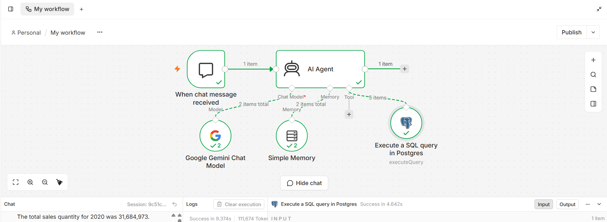

# AI-Powered Natural Language to SQL Agent

## Overview

This project explores how Generative AI and workflow automation can help business users retrieve insights from relational databases by asking questions in plain English instead of writing SQL manually.

The proposed solution combines **n8n, an AI agent, a Large Language Model (LLM), and PostgreSQL** to translate business questions into database queries and present the results in a conversational format.

This repository is a privacy-safe portfolio project inspired by a general business use case. It does not contain proprietary company code, internal database structures, production data, or confidential workflow exports.

## Problem Statement

Business users often depend on technical teams to retrieve information from databases. Even relatively simple questions can require SQL knowledge and additional turnaround time.

Examples of business questions include:

- Which cities generated the highest sales last month?
- What was the total sales value for a particular region?
- How many orders were delivered during a selected period?
- Which products generated the highest revenue?

The objective is to make structured data more accessible through a conversational interface.

## Proposed Solution

The workflow is designed to:

1. Accept a question through a chat interface.
2. Interpret the user's intent using an AI agent and an LLM.
3. Inspect available database schema information to identify relevant tables and columns.
4. Generate SQL appropriate to the question and available schema.
5. Execute an approved query against PostgreSQL.
6. Interpret the returned records and explain the result in plain English.
7. Ask a follow-up question when essential information is missing or the request is ambiguous.
8. Explain when the required data is unavailable rather than inventing an answer.

## Architecture

**User Question → Chat Trigger → AI Agent and LLM → Schema Discovery → SQL Generation → PostgreSQL Query Execution → Result Interpretation → Conversational Answer**

## Workflow Execution

The following screenshot shows the n8n workflow with the Google Gemini Chat Model, Simple Memory, and PostgreSQL query tool connected to the AI Agent.

## Key Capabilities

- **Natural Language to SQL:** Translate business questions into SQL.
- **Schema Awareness:** Use database metadata to understand available tables and columns.
- **Workflow Orchestration:** Coordinate AI reasoning and database operations using n8n.
- **Clarification Handling:** Request missing information when a question cannot be interpreted reliably.
- **Result Interpretation:** Present database results in understandable language.
- **Validation and Testing:** Evaluate generated SQL, result correctness, and edge cases.
- **Error Handling:** Communicate query or data limitations clearly.

## Technology Stack

- **n8n** — Workflow automation and orchestration
- **Generative AI / LLM** — Natural-language understanding and SQL generation
- **PostgreSQL** — Relational database
- **SQL** — Data retrieval and aggregation
- **Chat Interface** — User interaction

## Example Use Cases

| Business question | Intended capability |
|---|---|
| Show sales from Mumbai last month | Apply location and date filters |
| Which city has the highest total sales? | Aggregate sales and rank cities |
| Count delivered orders by region | Filter and group records |
| Show revenue for the previous quarter | Interpret a date range and aggregate revenue |
| Show sales by product | Group results by product |

These are illustrative questions. They do not represent queries against a real organization's database.

## Reliability and Validation

Generating SQL is only one part of a reliable text-to-SQL system. The solution should also be evaluated for:

- Correct interpretation of business terminology
- Valid table and column references
- Correct filters, joins, aggregations, and date ranges
- Appropriate handling of ambiguous questions
- Accurate interpretation of query results
- Clear responses when data is missing or a query fails
- Prevention of unauthorized or destructive database operations

Testing should use a synthetic dataset and known expected results wherever possible.

## Privacy and Security

The portfolio implementation should follow these principles:

- Use synthetic or otherwise authorized demonstration data.
- Keep API keys, passwords, and database credentials out of source control.
- Use environment variables or an appropriate secrets manager for credentials.
- Apply least-privilege database permissions.
- Prefer read-only database access for analytical questions.
- Validate generated SQL and restrict permitted operations.
- Avoid exposing confidential prompts, production schemas, internal URLs, or organizational data.

## Learning Outcomes

This project demonstrates practical exploration of:

- Generative AI and AI agent workflows
- Natural-language-to-SQL patterns
- PostgreSQL and relational data access
- Workflow automation using n8n
- Schema discovery and query validation
- Conversational data access for business users
- Privacy-aware design and error handling

## Project Status

**Status: Working prototype — initial end-to-end execution successful.**

The n8n workflow has successfully executed a natural-language request through the AI Agent and Google Gemini Chat Model, invoked a PostgreSQL query tool connected to Supabase, and returned a conversational answer.

### Implemented Components
- Chat-based input using the n8n Chat Trigger
- AI Agent powered by Google Gemini
- PostgreSQL query execution through Supabase
- Conversation memory using n8n Simple Memory
- Natural-language questions translated into SQL queries

### Next Steps
- Test multiple questions against known SQL results
- Validate ambiguous questions and unavailable data
- Document database schema and relationships
- Strengthen read-only database permissions and SQL safeguards
- Add sanitized screenshots and final test results

*This is an independent portfolio demonstration. The database data should be synthetic, and credentials, API keys, and private connection details are excluded from the repository.*

## Disclaimer

This repository presents a generalized portfolio design inspired by a business use case. It is an independent demonstration and is not the original production implementation of any employer or client system.
